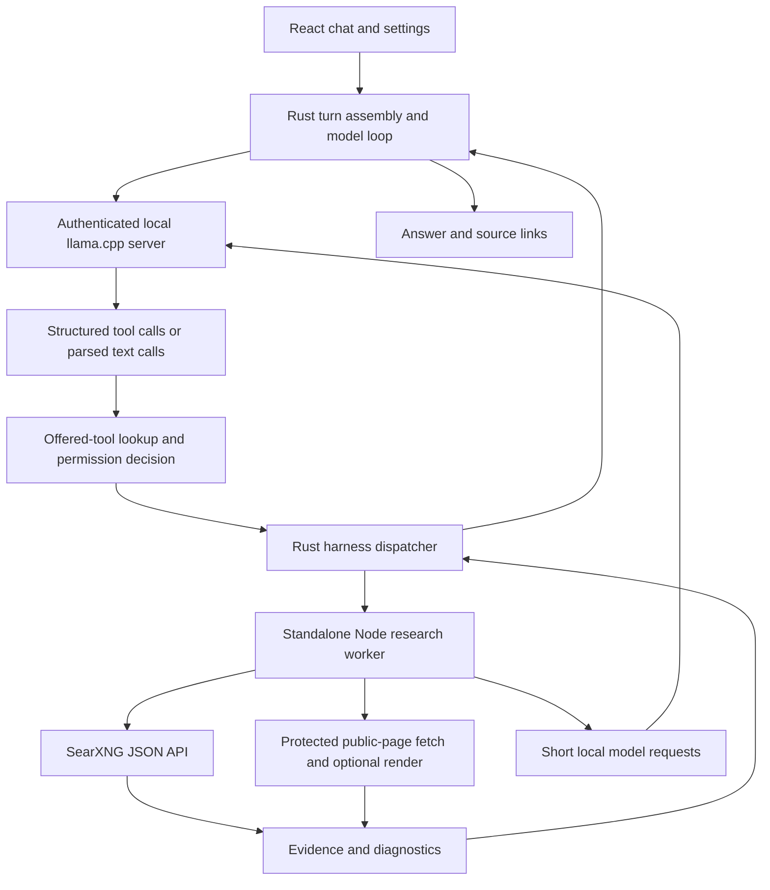

# Local model runtime and SearXNG audit — 30 September 2026

LocalLM already has the architecture needed to run a local model as a web research agent. SearXNG retrieves search results; llama.cpp runs the model; the Rust harness controls tool execution; a separate Node worker fetches and compresses evidence. Models do not run inside SearXNG.

The implementation compiles and its existing checks pass, but I found 20 actionable defects or contract inconsistencies in this path. Five deserve first priority because they affect offline behavior, local-provider compatibility, context capacity, or answer accuracy. Fifteen isolated reproductions demonstrate additional current behavior. Passing those reproduction tests means the defect was observed, not fixed.

This was a report-only audit. Application source, settings, model files, saved conversations, and the embedded worker were not edited. The report is new; diagnostic tests and separate builds live under the ignored `.local/web-runtime-audit-20260930/` directory. Findings describe the current shared checkout, which already contained substantial uncommitted work.

**What the application actually does**



The managed runtime picks an ephemeral loopback port, generates an API key, loads the selected GGUF, and enables `--jinja`. The chat loop receives OpenAI-style streaming tool calls, rejects incomplete arguments, checks that the tool was offered, obtains the required permission, executes it, and appends its result for the next round. The worker receives the managed endpoint and authentication through stdin. Its short inference requests carry system/user messages and no executable tools.

There are three relevant paths:

| Selected model or entry point | Current behavior |
| --- | --- |
| Managed generic GGUF, including the catalog MiniCPM5-2B | `web_search` uses staged local planning, search, bounded excerpts, sentence selection, and synthesis. The main model can continue using the tool result. |
| Managed model whose filename contains `AREX` | Generic search/fetch tools are replaced with `search`, `visit`, `update_context`, and `finish`. Search currently can invoke a nested planner; visit uses a model-generated brief. |
| External local OpenAI-compatible provider configured through Providers | Main turn assembly permits keyless loopback access, but snapshot creation does not. With a saved key, the worker still treats this provider as `remote` and receives no local extraction model. See finding 2. |
| Direct standalone current-fact question | Selected local questions about current versions, references, and benchmarks can enter research before the main model loop and return the worker answer directly. |
| Weather question | A separate direct shortcut can call structured weather retrieval. It has an offline-policy gap. |
| CLI without `LOCAL_LLM_BASE_URL` | Deterministic planning and attributed evidence; no model inference. |

The current code deliberately rejects non-loopback inference through `local_only::inference_allowed`. Some older documentation describes remote providers more broadly than this checkout permits.

**Findings, in repair order**

P1 means high-priority correctness or policy failure. P2 means a reproducible functional defect or a concrete contract inconsistency. Source-reviewed findings were established from the execution path; they were not exercised through a live native conversation.

1. **P1 — Offline mode does not cover all retrieval entry points.**

   [Harness dispatch](</C:/Users/Papan Ghosh/Desktop/Projects/LocalLM/src-tauri/src/harness.rs:341>) executes AREX `search` and `visit` before the offline guards used by `web_search` and `web_read`. `web_fetch_url` also reaches the fetch worker without that check. The [direct weather shortcut](</C:/Users/Papan Ghosh/Desktop/Projects/LocalLM/src-tauri/src/chat.rs:1773>) has no offline condition. The [native worker bridge](</C:/Users/Papan Ghosh/Desktop/Projects/LocalLM/src-tauri/src/web_search.rs:67>) checks `web_search_disabled`, but not `offline_mode`. An allowed call can therefore perform external retrieval while Offline is selected. This does not bypass the ordinary approval decision; it bypasses the additional offline policy.

   Fix: enforce the policy at the shared retrieval boundary, as well as before every non-worker network shortcut. Distinguish network actions from reading stored research and local verification. Test AREX search/visit, web_fetch_url, direct weather, and direct native research commands with a network spy and Offline enabled.

2. **P1 — Keyless external local providers fail during unconditional snapshot creation.**

   [Turn assembly](</C:/Users/Papan Ghosh/Desktop/Projects/LocalLM/src-tauri/src/chat.rs:978>) permits a verified loopback OpenAI-compatible provider with no key. [Snapshot creation](</C:/Users/Papan Ghosh/Desktop/Projects/LocalLM/src-tauri/src/subagents.rs:330>) instead requires a saved key. [Every chat send captures that snapshot](</C:/Users/Papan Ghosh/Desktop/Projects/LocalLM/src-tauri/src/chat.rs:1736>), even when no subagent is requested. The turn can pass initial validation and then fail with “Save an API key for the selected provider.”

   There is a second mismatch: snapshots for configured providers are labelled `remote`, even for loopback services, while `run_worker` supplies a model only when `kind == "local"`. Authenticated external local servers therefore use deterministic worker extraction instead of the selected local model.

   Fix: derive snapshots from the already validated backend, keep authentication policy consistent, and represent local network location separately from API adapter type. Preserve Claude-specific key requirements. Verify both keyless and authenticated loopback providers through a native send and a research tool call.

3. **P1 — Two inference slots halve the actual context while LocalLM budgets against the full value.**

   [Runtime arguments](</C:/Users/Papan Ghosh/Desktop/Projects/LocalLM/src-tauri/src/runtime_config.rs:93>) pass the configured context directly to `--ctx-size` and pass `--parallel 2` when two slots are selected. The pinned runtime is b10855, commit `7d701b592`. With explicit slots its default is non-unified KV; that runtime divides context by sequence count. Thus `--ctx-size 32768 --parallel 2` gives approximately 16384 tokens per slot. LocalLM nevertheless [records 32768 as runtime context capacity](</C:/Users/Papan Ghosh/Desktop/Projects/LocalLM/src-tauri/src/runtime.rs:268>), and chat/snapshots inherit it. This can admit prompts or output reserves that the server rejects. The cache estimate also multiplies configured context by slots, which is inconsistent with the currently emitted total-pool argument.

   This is verified against the [pinned context implementation](https://github.com/ggml-org/llama.cpp/blob/7d701b592/src/llama-context.cpp#L259), [server slot setup](https://github.com/ggml-org/llama.cpp/blob/7d701b592/tools/server/server.cpp#L139), and [slot capacity calculation](https://github.com/ggml-org/llama.cpp/blob/7d701b592/tools/server/server-context.cpp#L3639). It was not measured by loading a model during this audit.

   Fix: define whether the UI value means per-slot capacity or total allocation, emit consistent launch arguments, and read the effective slot capacity from runtime properties/logs. Use that measured capacity for all budgets and estimates. Until repaired, one slot avoids this specific mismatch.

4. **P1 — AREX visit can attach invented facts to a genuine source URL.**

   [ResultExtractor](</C:/Users/Papan Ghosh/Desktop/Projects/LocalLM/src/web/extraction/result_extractor.ts:52>) accepts generated lines after length/format filtering, without checking their content against the page. Reproduction: the page says “60 watts,” the model says “999 watts,” and the tool returns `SOURCE: https://example.org/spec` followed by the invented number. The downstream claim audit compares against collected tool text, so the generated brief can become its own apparent evidence.

   Fix: let the model select stable sentence/span IDs from retrieved text, as staged extraction already does. Construct evidence in application code. Keep raw passages and provenance in storage so verification can use original source text rather than a previous model's rewrite.

5. **P1 — Staged synthesis accepts a fact with reversed polarity.**

   [validSynthesis](</C:/Users/Papan Ghosh/Desktop/Projects/LocalLM/src/web/staged_research.ts:232>) checks source tags, numeric membership, a short list of comparative terms, and lexical overlap. It does not establish entailment or reject negation changes. Reproduction: retrieved evidence says an adapter supports charging; the accepted answer says it “does not support” the same charging. This can reach the user directly through the current-fact shortcut.

   Fix: use an evidence-preserving final format or conservatively reject altered polarity, units, entity-to-number relationships, and unsupported clauses. The deterministic attributed fallback is safer than accepting an unverified paraphrase. A lexical match should not be labelled verification.

6. **P2 — Worker stdin corrupts split UTF-8 characters.**

   [Input accumulation](</C:/Users/Papan Ghosh/Desktop/Projects/LocalLM/scripts/web-worker.mjs:45>) concatenates each Buffer into a string. That decodes every chunk independently. A Chinese character split across two pipe buffers becomes replacement characters even though the incoming byte stream is valid UTF-8. A standalone worker reproduction confirms corrupted search queries.

   Fix: call `process.stdin.setEncoding('utf8')`, use `StringDecoder`, or concatenate bounded Buffers before decoding. Apply the same discipline to CLI/smoke output accumulators. Test buffer boundaries inside multibyte characters.

7. **P2 — Valid table evidence is discarded when an unrelated prose extraction fails.**

   [Table and prose extraction](</C:/Users/Papan Ghosh/Desktop/Projects/LocalLM/src/web/staged_research.ts:347>) share one try block. Deterministic table facts are computed first, but are added only after the prose model request succeeds. A reproduction with a valid 81%/79% benchmark table plus a prose source returns no facts when the model throws.

   Fix: commit validated table facts independently; catch prose failures separately. Preserve successful evidence and identify only the failed component.

8. **P2 — JSON-text AREX query arrays are validated but forwarded without decoding.**

   AREX validation supports structured values encoded inside strings. The [search handler](</C:/Users/Papan Ghosh/Desktop/Projects/LocalLM/src-tauri/src/harness.rs:349>) decodes `queries` for its repeat key but forwards raw `args["query"]` to the worker. The worker interprets the JSON string as one query. Reproduction: two encoded queries become one malformed combined query, whereas the equivalent real array yields two. The smoke driver decodes this form itself, so that driver can miss the native mismatch.

   Fix: forward the validated decoded array, preserving order/content independently of cache-key normalization. This matters for the structured parameters in [BAAI's published AREX contract](https://huggingface.co/BAAI/AREX-Turbo/blob/main/inference/prompts.py).

9. **P2 — Query rewriting destroys search operators and exact phrases.**

   [compactQuery](</C:/Users/Papan Ghosh/Desktop/Projects/LocalLM/src/web/planning/fallback_planner.ts:30>) removes colons and quotes. It turns `site:example.org "adapter charging"` into `site example.org adapter charging`. AREX's already planned queries pass through this function, so source restrictions can disappear. [SearXNG's API](https://docs.searxng.org/dev/search_api.html) permits underlying search-service syntax, including `site:`.

   Fix: preserve explicit agent queries; apply keyword shortening to natural-language questions only. If rewriting is necessary, parse and retain operators and quoted spans.

10. **P2 — AREX visit ignores relevant information beyond the first 12000 characters.**

    The extractor slices a fixed prefix before relevance selection. A reproduction places the valid charging fact later in the page and receives `NO_RELEVANT_INFO`. The tool text says the page held nothing for the goal, when only its prefix was examined.

    Fix: rank/chunk the full bounded retrieved document before selecting a small input. Report the inspected scope when coverage is partial.

11. **P2 — Staged filtering drops different useful pages merely because they share a domain.**

    [Snippet selection](</C:/Users/Papan Ghosh/Desktop/Projects/LocalLM/src/web/staged_research.ts:124>) allows one result per domain. A reproduction with two official product pages keeps only one. Comparisons, release histories, or multiple benchmark pages from one publisher can lose necessary evidence before fetching.

    Fix: deduplicate URLs/content first; prefer diversity without making it a one-page-per-publisher prohibition. Allow multiple relevant official pages within a bounded result budget.

12. **P2 — Engine outages are treated as successful empty searches.**

    [SearXNG parsing](</C:/Users/Papan Ghosh/Desktop/Projects/LocalLM/src/web/search/searxng_provider.ts:248>) records `unresponsive_engines` but returns an empty successful result when every engine failed. SearchService reports zero failures, so the agent is told to reword the query rather than inspect the provider. [checkEngineHealth](</C:/Users/Papan Ghosh/Desktop/Projects/LocalLM/src/web/search/searxng_provider.ts:167>) marks any non-fixture HTTP 200 response as working, including one listing the requested engine as unresponsive. Both behaviors reproduce.

    Fix: parse engine/reason pairs and carry per-query diagnostics. Distinguish healthy zero hits, partial engine failure, and all selected engines failing. This should not discard results from healthy engines.

13. **P2 — Retry-After protection disappears between tool calls.**

    The SearXNG cooldown is an instance field. The Rust bridge starts a fresh worker for every call, creating a fresh provider. Reproduction: an endpoint sends `429 Retry-After: 120`; two successive workers both call it within a second. Existing provider tests verify only reuse within one instance.

    Fix: persist endpoint cooldowns in the research store or Rust supervisor and check them before launching a request. Keep cooldowns per endpoint rather than suppressing healthy alternatives.

14. **P2 — Google's connection check reports ready without checking a connection.**

    [getHealthStatus](</C:/Users/Papan Ghosh/Desktop/Projects/LocalLM/src/web/index.ts:164>) initializes search to `ready` and probes only SearXNG. With Google selected, even a fetch stub that throws is never called and the health result stays ready. The UI presents that result under Check connection.

    Fix: distinguish configured from verified. Validate credentials with a documented probe and disclose when it consumes a query, or make the UI explicitly show that Google was not tested.

15. **P2 — The Google 90-call limit is not a reliable limit.**

    [Quota reservation](</C:/Users/Papan Ghosh/Desktop/Projects/LocalLM/src/web/index.ts:143>) tests only `used >= limit`, then adds an entire batch. A counter at 89 permits four queries and becomes 93. Retries are not reserved individually. Separate workers use a read-then-write sequence, so concurrent reservations can also race. The deterministic non-staged path does not apply the same reservation to its Google primary search.

    Fix: reserve every actual request atomically in SQLite, including retries/pagination and every entry point. Require `used + requested <= limit`. Keep the configured application cap distinct from the provider's account quota.

16. **P2 — Google ignores requested freshness and page number.**

    [GoogleSearchProvider](</C:/Users/Papan Ghosh/Desktop/Projects/LocalLM/src/web/search/google_provider.ts:15>) sends query/count/language but never uses `freshness` or `page`. A requested day filter and page 2 produce neither `dateRestrict` nor `start`. Thus provider fallback can silently broaden a current-information search, and additional-page retrieval repeats page one. Google's [official cse.list contract](https://developers.google.com/custom-search/v1/reference/rest/v1/cse/list) supplies both parameters.

    Fix: map supported freshness windows and page offsets explicitly. Record unsupported/broadened freshness rather than claiming the requested constraint was applied.

17. **P2 — Staged fallback hides which provider supplied the evidence.**

    [searchQueries](</C:/Users/Papan Ghosh/Desktop/Projects/LocalLM/src/web/index.ts:203>) replaces the primary outcome with the fallback outcome. [researchStaged](</C:/Users/Papan Ghosh/Desktop/Projects/LocalLM/src/web/index.ts:403>) reports the configured primary name regardless. A reproduction obtains evidence from Google but reports `providerUsed: searxng`. Primary diagnostics are lost in the replacement.

    Fix: return provider identity, attempts, fallback reason, and failures with each search batch; aggregate those actual outcomes into the session trace. Keep both providers' diagnostics when both fail.

18. **P2 — SearXNG URLs hosted below a path prefix are broken.**

    [Search URL construction](</C:/Users/Papan Ghosh/Desktop/Projects/LocalLM/src/web/search/searxng_provider.ts:205>) uses `new URL('/search', baseUrl)`. For `https://host/searxng/`, the request goes to `https://host/search`, losing `/searxng/`. The same issue exists in the per-engine health helper.

    Fix: either reject prefixed URLs with an actionable message or normalize the service base and append `search` relative to that prefix. Cover both origin-only and subpath deployments.

19. **P2 — Fresh installations default fallback to false despite the declared true default.**

    [Native config reads](</C:/Users/Papan Ghosh/Desktop/Projects/LocalLM/src-tauri/src/web_search.rs:200>) use `setting::<bool>(...).unwrap_or(true)`. [Store::setting](</C:/Users/Papan Ghosh/Desktop/Projects/LocalLM/src-tauri/src/store.rs:2065>) returns `Ok(T::default())` for a missing setting, so a missing bool returns false; `unwrap_or(true)` never runs. Both worker launch and the settings getter use this pattern. This differs from TypeScript defaults and the initial UI state.

    Fix: read `Option<bool>` and apply true only for an absent setting, retaining an explicitly saved false. Test missing, true, and false values.

20. **P2 — Google credentials are stored as ordinary plaintext settings.**

    [save_web_search_config](</C:/Users/Papan Ghosh/Desktop/Projects/LocalLM/src-tauri/src/web_search.rs:221>) passes the key to `save_setting`, which serializes directly into SQLite. The getter returns the actual secret to the settings UI. Other provider credentials already use the vault. No user key or database was inspected in this audit.

    Fix: migrate Google keys to the existing credential vault, expose presence rather than the saved secret, and avoid secret-bearing diagnostic URLs. Retain compatibility long enough to migrate existing settings safely.

**Additional limits and design concerns**

These are observed constraints or risks; they are not presented as proven native-model failures:

- Four AREX pages are fetched and extracted with `Promise.all`, although the managed runtime defaults to one inference slot. Each nested request's 45-second timer includes server queue time. A slow model can cause later page extractions to time out and fall back. Fetch concurrency and model concurrency should be separate; use the effective slot count and a shared remaining deadline.
- Full research has a 240-second outer limit, but staged research can attempt several serial searches, retries, fetches, and model calls without receiving that remaining deadline. It can lose all partial work when the supervisor kills it. Pass a deadline through stages and return partial evidence on expiry.
- Staged mode limits do not match the older fast/normal/deep pipeline documentation. Planning caps at four; page allowance comes from initial query count times three plus comparison follow-ups, rather than `fetch.fastPages/normalPages/deepPages`. Several declared cache, retrieval, reranking, and verification controls apply to the other pipeline, not staged research. Make effective configuration explicit and test the actual selected path.
- Worker input counting tokenizes concatenated prompt text plus a fixed 64-token allowance; main chat uses the runtime's exact `/v1/chat/completions/input_tokens` endpoint. Prefer the same exact rendered-message accounting for nested requests, including the requested output reserve.
- The AREX extractor does not request thinking to be disabled, unlike the short staged planner/extractor calls. Reasoning-capable models can spend the small generation allowance on thinking and fall back without a visible reason. Make the short-call policy explicit and expose fallback diagnostics.
- `web-search.json` overrides saved UI provider settings last. A stale override can make the UI appear saved while the worker uses another endpoint/provider. This precedence is intentional in code, but the effective values and override source are absent from the UI.
- SearXNG's week freshness becomes month, and engines differ in time-filter support. This is a broadened search window, not evidence that every result is within seven days. Preserve freshness provenance.
- Older Phase 1 and AREX documentation contains stale descriptions of nested planning, stored-page access, rendering, and claim-audit inputs. Current code should drive updated documentation.
- The standalone AREX smoke driver is useful, but it is a separate loop with its own decoding/launch choices. It does not prove that native permissions, snapshots, offline gates, and chat result handling are correct.

**What is already sound**

The audit did not find a compile failure, stale embedded worker, or missing tool registry in the reviewed flow. The normal chat dispatcher rejects tools that were not offered; malformed/truncated arguments are rejected rather than guessed. Worker installation is content-addressed and uses atomic publication. Worker execution is cancellable and bounds stdout/stderr. Protected public-page fetching pins public addresses, validates redirects, and has robots/HTTP failure tests. The current optional rendering code mediates requests rather than using unrestricted raw Edge navigation. Failed fetches carry structured errors. Staged sentence selection validates excerpts against supplied evidence, and citation URLs are owned by the application.

These controls remain useful, but they do not fix the policy and grounding gaps above. In particular, a correct citation URL does not establish that the cited claim appeared on the page.

**How to run local research with the existing app**

1. In Models, select a complete GGUF and its compatible llama.cpp runtime. MiniCPM5-2B uses the ordinary catalog path. AREX filenames trigger the special tool adaptation. K2 Horizon requires its neighboring project's custom runtime when discovered as an external model. Other GGUFs need a supported architecture and a working tool-call template/parser; being a GGUF alone does not establish reliable agent behavior.
2. Configure a valid Node executable under Execution. The worker uses `node:sqlite`; Node 22.13+ removes the experimental command-line flag requirement, as documented by [Node](https://nodejs.org/api/sqlite.html). This machine has Node v24.14.1.
3. Run SearXNG separately. The repository's [compose file](</C:/Users/Papan Ghosh/Desktop/Projects/LocalLM/docker-compose.yml>) pins `searxng/searxng:2026.9.22-019460e07` and binds port 8080 to Windows loopback. [settings.yml](</C:/Users/Papan Ghosh/Desktop/Projects/LocalLM/searxng/settings.yml>) already enables JSON. On a machine with Docker available, the command is `docker compose up -d searxng`. WSL is another deployment option documented in the repository. Do not expose this local configuration as a public instance without revisiting its server settings.
4. Use Settings → Web search to select SearXNG and set `http://127.0.0.1:8080`. Verify that `/search?q=...&format=json` returns real results, not just that the root page loads. SearXNG returns 403 when the requested output format is not enabled, per its [Search API documentation](https://docs.searxng.org/dev/search_api.html).
5. Load the model through the app and retest tool calling for that runtime/model combination. The app already supplies `--jinja`, which is required for the documented llama-server tool transport. Template support and model behavior still matter; see [llama.cpp function calling](https://github.com/ggml-org/llama.cpp/blob/master/docs/function-calling.md).
6. Start with one inference slot and a context that fits the model and hardware. For a diagnostic run, 8192 tokens is a reasonable initial application setting when supported; measure memory and prompt usage before enlarging it. This is an operational starting point, not a universal model requirement. Nested research is currently capped at 6000 input tokens and requires at least 2400 configured tokens through the native bridge.
7. Choose Standard, Research, Creator, or Code for generic web_search, subject to the offered tools. AREX uses the search/visit/finish flow. Honor the selected permission mode. Keep Offline off for an intentional live-search run until the policy gaps are fixed.
8. Check a known-answer task: search for a primary page, visit it, verify an exact number/date against the original page, finish with the matching URL, then test an unavailable provider and cancellation. A convincing answer alone is insufficient evidence that the search path ran.

For a separately running local server, the repository CLI supports:

```powershell
$env:LOCAL_LLM_BASE_URL = 'http://127.0.0.1:8081/v1'
$env:LOCAL_LLM_MODEL = 'the-loaded-model-id'
npm run research -- ask 'Find the official release notes for a specified version' --trace --sources
```

The CLI does not currently expose the managed model's API key through these environment variables. Use the native app for its authenticated managed server, or extend CLI configuration deliberately; do not disable managed authentication as a workaround.

At audit time, no `locallm` or `llama-server` process was running, no listener existed at the default SearXNG port, and `docker` was not available on this shell's PATH. Running the embedded worker's default health action with an in-memory database returned `search: unreachable`, `database: sqlite_ready`, and `llm: deterministic_fallback_ready`. Those are environment prerequisites, separate from the defects. No model or SearXNG instance was started and no live model-plus-search conversation was claimed.

**Recommended final behavior and implementation sequence**

Retain the Rust harness, local llama.cpp, Node worker, and SearXNG separation. Replacing the runtime or search stack is not needed to address these findings.

1. Centralize backend snapshot creation, authentication policy, effective slot capacity, and retrieval gating. Cover all native entry points with policy tests before adjusting answer-generation behavior.
2. Store bounded original passages with stable IDs, real URL, fetched/archived time, and evidence kind. Models may select evidence IDs and propose wording; application code validates the selection and constructs citations. Verify final assertions against original evidence, not a model-generated extraction brief.
3. Preserve partial table/text evidence across independent component failures. Use one shared research deadline and separate network/model concurrency. Surface explicit statuses such as provider unavailable, engines failed, no hits, fetch failed, extraction failed, partial evidence, and complete.
4. Preserve validated agent queries, structured argument arrays, deployment prefixes, actual provider identity, and freshness constraints. Persist cooldowns and reserve quota atomically per actual request. Move secrets to the vault.
5. Align settings and documentation with effective staged behavior. Add the isolated reproductions to the maintained suite with assertions inverted to require the fixed behavior. Add native keyless-provider, Offline, two-slot, failure-recovery, and cancellation tests.

**Verification and evidence**

| Check | Result |
| --- | --- |
| `npm run typecheck` | Passed, app and e2e TypeScript |
| `npm run lint` | Passed with warnings denied |
| `npm test` | 422 passed, 1 skipped; existing jsdom canvas warning |
| `cargo test --locked --manifest-path src-tauri/Cargo.toml` | 385 passed, 2 ignored; binary/doc targets also passed |
| `cargo clippy --locked --manifest-path src-tauri/Cargo.toml --all-targets -- -D warnings` | Passed |
| Node transport/render/bundled/staged worker tests | 25 passed |
| Playwright, Edge channel, app e2e suite | 10 passed; temporary config used Vite directly to avoid rewriting the embedded worker |
| Isolated TypeScript defect reproductions | 12 passed, asserting current defective behavior |
| Isolated standalone-worker defect reproductions | 3 passed, asserting current defective behavior |
| Separate worker build | Successful; byte-for-byte identical to the embedded bundle |
| Separate production UI build | Passed; existing large-chunk advisory, output kept under `.local/` |
| Default worker health | Search unreachable; SQLite ready; deterministic path available |
| Real local model + real SearXNG native conversation | Not run; prerequisites were not running |

Embedded and independently rebuilt worker SHA-256: `a286c84f6cea93788d412789d0a44334e4e0d9a2474acfe139be7c1aae25d90a`. Build comparison used `.local/` and did not replace the application resource.

The reproductions are [TypeScript tests](</C:/Users/Papan Ghosh/Desktop/Projects/LocalLM/.local/web-runtime-audit-20260930/repro.test.ts>) and [standalone-worker tests](</C:/Users/Papan Ghosh/Desktop/Projects/LocalLM/.local/web-runtime-audit-20260930/worker-repro.test.mjs>). Run them from the repository root:

```powershell
npx vitest run --config .local/web-runtime-audit-20260930/vitest.config.mjs
node --test .local/web-runtime-audit-20260930/worker-repro.test.mjs
```

This review covers the model/runtime/research path and relevant UI/configuration boundaries. Passing existing tests establishes their checked behavior, not the absence of further defects throughout the application.
